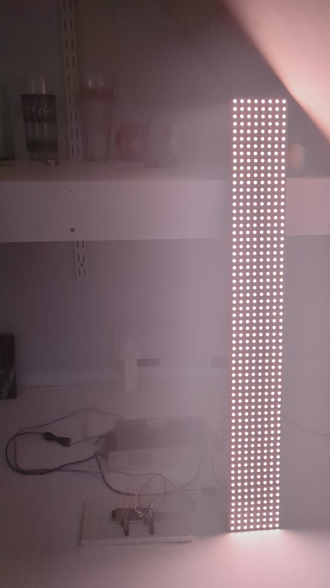
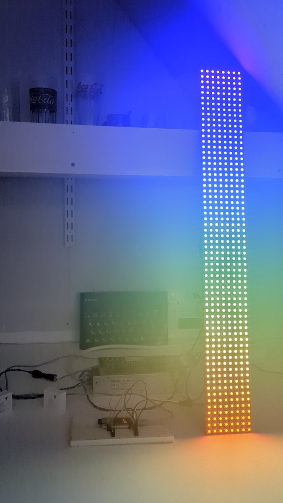
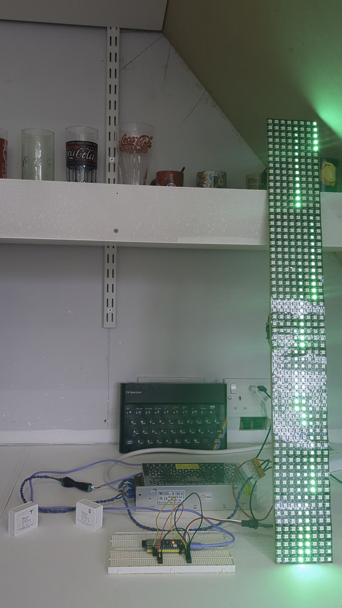
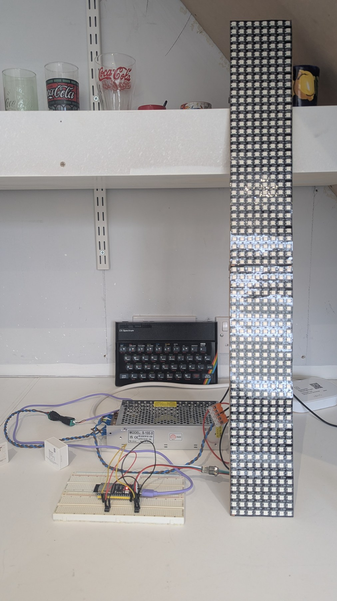

# WLED Staircase

Stair lights that fill one step at a time as you walk in, hold while you're on
the stairs, then empty the way you came. A **PIR at each end** is what sets them
off — the two buttons on the controller are a diagnostic, not a control.

The sweep isn't a WLED effect — it's WLED's **Animated Staircase usermod**, which
isn't in any stock WLED download, so the firmware has to be built. This repo
hands you that build: an **ESP32-S3** running **WLED 16.0.1** with the usermod
and **eight patches** that fix how it behaves (the off-sweep follows you, the
hold starts when the sweep finishes, buttons wire straight to ground, presets
switch the whole thing on and off cleanly, and "All" fades instead of snapping).
The binary is here ready to flash,
and so is everything needed to rebuild it.

On top of that: six modes, ten presets, and three Home Assistant automations
that decide when the stairs are live.

🎮 **[Try the interactive demo](https://sygad.github.io/wled-staircase/)** — the dashboard card on the left, the
stairs on the right. Press a trigger and watch the sweep, switch modes, set the
alarm and trip the top sensor. No hardware needed.

### 🎥 Watch it

| Sweep | Rainbow | Matrix |
|:---:|:---:|:---:|
| [](https://youtube.com/shorts/vzJJwnvL0dU) | [](https://youtube.com/shorts/ZnB6A8TEL7Y) | [](https://youtube.com/shorts/ZnB6A8TEL7Y) |
| ▶ **[Sweep on YouTube](https://youtube.com/shorts/vzJJwnvL0dU)** | ▶ **[Rainbow, then Matrix, on YouTube](https://youtube.com/shorts/ZnB6A8TEL7Y)** | |

Two YouTube Shorts of the bench rig: a warm-white **Sweep** filling down from
the top step, holding and emptying; then a **Rainbow** sweep followed by
**Matrix** rain.

---

## ⚠️ This is a prototype

**My staircase isn't 64 steps.** I wanted to see what the effect actually looked
like at full height before committing it to the stairs, so I built it on two
32 × 8 WS2812B panels chained into a single **8 × 64 matrix** — 512 LEDs, compact
on the bench and very tall on screen, with each row of 8 standing in for one step.

Nothing about that is a fudge: the firmware, the presets and the Home Assistant
side are identical on real stairs. Wherever this repo says **rows**, read **your
number of steps** — one short strip per step, wired as one chain, up to 64 of
them. The [demo](https://sygad.github.io/wled-staircase/) shows exactly what the bench rig does.

<p align="center">
  <a href="images/build-bench.jpg"></a>
</p>

*The bench rig: the two panels standing as one 64-row column, the ESP32-S3 on a
breadboard with its two diagnostic buttons, the 5 V supply behind it, and the two
Zigbee PIRs (marked T and B) on the left. More photos in
[Part 1](parts/01-hardware/README.md) and [Part 2](parts/02-wiring/README.md).*

---

## The whole build in one picture

<a href="https://raw.githubusercontent.com/sygad/wled-staircase/main/images/wiring.svg" title="Open the wiring diagram full screen">
  
</a>

*Click the diagram to open it full screen.* Five wires and two buttons — the
whole of it is in [Part 2 · Wiring and power](parts/02-wiring/README.md).

---

## How this repo works

Every piece of the build has a **number**, and that number is used everywhere:
in the table below, in the folder name, and in the links between pages. Drop in
at any part without reading the rest.

```
README.md                       this page
BUILD-WITH-AI.md                point your own AI at the repo and let it build it
docs/index.html                 the interactive demo, served by GitHub Pages
device/                         the exact backup from my controller
  cfg.json                        every WLED setting
  presets.json                    presets 1-10, byte-for-byte
  palette0.json                   the custom palette the Disco preset needs
tools/
  make_staircase.py             generates the settings and presets for YOUR steps
parts/
  01-hardware/                  board, panels, supply, and why each one
  02-wiring/                    five wires, two buttons, one diagram
  03-firmware/                  pre-built binaries + the build environment
  04-behaviour-patches/         the six patches that make the stairs behave
  05-wled-settings/             LED output, the 8x64 matrix, the usermod
  06-presets/                   the ten presets, and what each one carries
  07-home-assistant/            three helpers, three automations, a script, two cards
  08-testing/                   the two scripts that prove it works
shared/                         five tricks several parts depend on
images/                         the wiring diagram, build photos, stills from the videos
```

**Pick your route:**

| I want to… | Go to |
|---|---|
| See what it actually does | [The interactive demo](https://sygad.github.io/wled-staircase/) |
| Have an AI build it for me | [BUILD-WITH-AI.md](BUILD-WITH-AI.md) |
| Build all of it myself | [Quick start](#quick-start) |
| Take just one part | [The parts](#the-parts): open that part's folder |
| Understand the firmware changes | [Part 4 · The behaviour patches](parts/04-behaviour-patches/README.md) |

---

## The parts

| # | Part | What it does | Built from |
|---|---|---|---|
| 1 | [Hardware](parts/01-hardware/README.md) | The board, the panels and the supply, and why not the cheaper options | ESP32-S3 N16R8, 2 × 32 × 8 WS2812B, 5 V 20 A |
| 2 | [Wiring and power](parts/02-wiring/README.md) | Five wires, two buttons, no resistors, power injection | [wiring.svg](images/wiring.svg) |
| 3 | [Firmware](parts/03-firmware/README.md) | A custom WLED 16.0.1 build: 64 segments, staircase + audioreactive usermods | [WLED](https://github.com/wled/WLED) 16.0.1 |
| 4 | [The behaviour patches](parts/04-behaviour-patches/README.md) | P1–P9: sweep direction, hold timing, active-low buttons, clean preset switching, fades on All, power back up mid-fade | WLED's Animated Staircase usermod |
| 5 | [WLED settings](parts/05-wled-settings/README.md) | 512 LEDs as one 8 × 64 matrix, 17 A limit, 100 ms per step | WLED settings / JSON API |
| 6 | [The ten presets](parts/06-presets/README.md) | Sweep, Rainbow, All, Matrix, Disco, Danger, Off, the two triggers and Danger's fade-out | WLED presets |
| 7 | [Home Assistant](parts/07-home-assistant/README.md) | PIRs, day/night, mode dropdown, the red alarm flash, two dashboard cards | WLED integration, Bubble Card |
| 8 | [Testing](parts/08-testing/README.md) | One script that reads the setup, one that drives every preset change | Python 3, no packages |

Tricks that several parts lean on — the segment-per-step layout, WLED 16's
colour-copying, the `Content-Type` trap, the one-power-source rule — are
explained once in **[shared/README.md](shared/README.md)**.

---

## What it does

| Mode | What happens |
|---|---|
| **Sweep** (default) | Warm white fills in the direction you walked in, 100 ms per step, holds 5 s with every step lit, then empties the same way |
| **All** | Every step together: fades up over 0.5 s, holds 5 s, fades away over 2 s |
| **Rainbow** | The same sweep, each step a fixed colour: red at the bottom through to violet at the top |
| **Matrix** | 2D green rain, falling top to bottom, continuously |
| **Disco** | 2D graphic-equaliser bars rising from the bottom (sound-reactive once a microphone is fitted) |
| **Danger** | Not a mode you pick: a top sensor while the alarm is armed fades everything up red over 0.2 s, holds five seconds, fades away over 0.5 s, then puts the previous mode back |
| **Off** | Dark — but the hardware buttons still work |

**When it runs.** These are lights for the dark: Home Assistant only lets the
**motion sensors** light the stairs between sunset and sunrise, worked out from
`sun.sun` rather than a clock, so it tracks the seasons on its own. The **Night
mode** toggle opens that window when you want them live anyway — a gloomy
afternoon, or showing somebody — and latches until you turn it off. There is no
master switch: the card is about the staircase and nothing else.

Three things sit outside that window. **Matrix** and **Disco** run from the moment
you select them, day or night. **Danger** answers to the alarm alone, because an
alarm armed in the afternoon has to warn you in the afternoon. And the two
**hardware buttons** on the controller are a diagnostic — wired straight to the
GPIO, gated by nothing at all, so **they work with Home Assistant switched off**,
with Zigbee down, and in broad daylight. After a power cut the controller comes
back as Sweep on its own.

---

## ✅ Do / ❌ Don't

The short version of everything that went wrong while building this.

| ✅ Do | ❌ Don't |
|---|---|
| Wire both buttons straight to **GND** | Wire them to 3.3 V. This firmware reads them active-low (patch P4) |
| Join the ESP32-S3 **GND** to the LED supply **GND** | Skip the common ground. The LEDs ignore the data |
| Set the **power limiter** to about 85 % of your supply | Leave it at WLED's default and wonder why white browns out |
| Feed **both ends** of a 512-LED chain | Feed only the bottom. The top steps go dim and yellow |
| Check the first LED is at the **bottom** with a one-row test | Trust the panel's label. Half of them are top-start |
| Switch mode by selecting a **preset** | Push colours or effects from Home Assistant. It races the firmware |
| Regenerate presets with `tools/make_staircase.py` | **Re-save presets 1–7 from the WLED UI.** It drops the staircase block and copies one colour over every row |
| Name the device **before** adding it to Home Assistant | Rename it afterwards. The entity IDs don't change |
| Update with this project's **`_OTA.bin`** | Use WLED's online update. Stock firmware has no staircase usermod |
| Power the board from USB **or** the 5 V supply | Connect both at once |
| Back up `cfg.json` and `presets.json` once it works | Learn the preset JSON twice |

---

## What you need

### Hardware

| Part | What I used | Used by |
|---|---|---|
| Controller | diymore **ESP32-S3 DevKitC-1 N16R8** (16 MB flash, 8 MB octal PSRAM) | all |
| LEDs | Two **32 × 8 WS2812B** panels, chained: 512 LEDs as one 8 × 64 matrix | 1, 2, 5, 6 |
| Power | **5 V 20 A** supply (Weishuo S-100-5), injected at both ends of the chain, limited to **17 A** in WLED | 1, 2 |
| Triggers | 2 × momentary push buttons, to GND, **no resistors** | 2, 4 |
| Motion | Zigbee PIRs that already exist in Home Assistant | 7 |
| Microphone | **INMP441** I2S — specified, not fitted yet | 1, 6 |

An ESP32-S3 **with PSRAM** is required for more than 32 steps: WLED allows 64
segments on a board with PSRAM and only 32 without, and this build needs one
segment per step.

### Software, with the versions this was built and tested on

| | Version | Needed for |
|---|---|---|
| [WLED](https://github.com/wled/WLED) | **16.0.1**, built from source | all |
| PlatformIO + Node.js | Node 20 | only if you build the firmware yourself |
| Home Assistant | **2026.10.2** | part 7, optional |
| [Bubble Card](https://github.com/Clooos/Bubble-Card) | **v3.4.2** via HACS | the nicer card only; a built-in-cards version is included |
| Python 3 | 3.9+, no packages | `tools/` and `parts/08-testing/` |

---

## Quick start

My stairs are 64 steps × 8 LEDs. Yours won't be, and that's fine: the step count,
pins and timings are **settings**, not compiled in. Anything up to 64 steps works
with the pre-built firmware.

1. **Wire it** as in [Part 2](parts/02-wiring/README.md). Leave the LED supply off
   the board while it's on USB.
2. **Flash** `parts/03-firmware/WLED_16.0.1_ESP32-S3_Staircase_FACTORY.bin` at
   address `0x0` with [esptool-js](https://espressif.github.io/esptool-js/) —
   [Part 3](parts/03-firmware/README.md).
3. **Join it to Wi-Fi** through the WLED-AP hotspot, and **name it now** if you
   plan to use Home Assistant — [Part 7](parts/07-home-assistant/README.md).
4. **Settings and presets**, in one command — [Part 5](parts/05-wled-settings/README.md)
   and [Part 6](parts/06-presets/README.md):
   ```bash
   python3 tools/make_staircase.py --rows 64 --width 8 --name "WLED Staircase" --ip <ip> --apply
   curl -F 'data=@out/palette0.json;filename=/palette0.json' http://<ip>/upload
   curl -X POST -H "Content-Type: application/json" -d '{"rb":true}' http://<ip>/json/state
   ```
5. **Check it** — [Part 8](parts/08-testing/README.md):
   ```bash
   python3 parts/08-testing/check_device.py --host <ip> --rows 64 --width 8
   ```
6. **Press a button.** If the wrong end lights first, your matrix is top-start:
   fix it in WLED's 2D Configuration, not in the presets.
7. **Home Assistant**, if you want the PIRs, the day/night rule and the card —
   [Part 7](parts/07-home-assistant/README.md).
8. **Back it up:** Config → Security & Updates → Backup configuration and Backup
   presets.

---

## Swap in your own steps, pins and entities

| Find | Replace with | Where |
|---|---|---|
| `--rows 64` | your number of steps (max 64) | `tools/make_staircase.py` |
| `--width 8` | your LEDs per step | " |
| `--data-pin 12` | your LED data GPIO | " |
| `--bottom-pin 4` / `--top-pin 5` | your trigger GPIOs, or `-1` for none | " |
| `--max-ma 17000` | ~85 % of your supply, in mA | " |
| `--step-ms 100` / `--on-time 5` | your taste | " |
| `select.wled_staircase_preset` | your WLED device's preset select | `parts/07-home-assistant/*.yaml` |
| `light.wled_staircase` | your WLED device's main light | " |
| `binary_sensor.staircase_*_pir_occupancy` | your two occupancy sensors | " |
| `alarm_control_panel.home_alarm` | your alarm panel, or delete Danger | " |
| `input_boolean.motion_sensors` | your own master motion toggle, or delete the condition (the PIR automation only) | " |

Every Home Assistant file is marked up: **search for `CHANGE`**.

---

## Troubleshooting

| Problem | Likely cause |
|---|---|
| Nothing happens when I press a button | No common ground, or the button is wired to 3.3 V instead of GND. Check `http://<ip>/json/state`: idle must show `"top-sensor":false,"bottom-sensor":false` |
| The bottom button lights the top of the stairs | The matrix is top-start, or the two GPIOs are swapped. Fix *first LED = bottom* in 2D Configuration |
| The far end never lights | The on-time is shorter than the sweep — but on this firmware it shouldn't be, because patch P3 starts the hold after the sweep. Check you're running this build (`/json/info` → `"release":"ESP32-S3_Staircase"`) |
| Rainbow shows all one colour | A preset was re-saved from the UI. Regenerate with `tools/make_staircase.py` |
| Rows flash twice during the sweep | Not this firmware — check `/json/info` → `"release":"ESP32-S3_Staircase"`. The step-pacing and fade fixes are in [Part 4](parts/04-behaviour-patches/README.md#10-three-fixes-for-64-segments-on-wled-16) |
| Switching to Matrix or Disco plays an off-sweep first | Same: that build is missing patch P6. Rebuild from [Part 4](parts/04-behaviour-patches/README.md) |
| The top steps are dim or yellow | Voltage drop. Inject power at the far end |
| Full white is dimmer than I expected | That's the power limiter doing its job. 512 LEDs at full white want about 28 A; on a 20 A supply WLED caps them at 17 A and dims everything evenly. Fit a bigger supply and raise `--max-ma` if you want more |
| The Disco bars are the wrong colours | `palette0.json` isn't on the controller. Upload it and reboot |
| The hardware buttons do nothing | They should always work, in daylight too — **Stairs Off** parks the strip but leaves the staircase logic enabled. Check `/json/cfg` → `um.staircase.enabled` is `true`. The one case where they are deliberately dead is while **Matrix**, **Disco** or **Danger** is running — [Part 7](parts/07-home-assistant/README.md) |
| Every trigger lights the whole staircase red | A **Danger** ran, and the controller is still carrying Danger's single full-matrix segment. Preset 7 is meant to rebuild the 64 rows — regenerate it with `tools/make_staircase.py` and check `/json/state` shows 64 segments after selecting **Stairs Off** |
| Phone and Home Assistant triggers do nothing | Same cause, or you're in Matrix or Disco, where triggers are ignored by design |
| All snaps on and off instead of fading | A build without patch P7, or `fade-in-ms` / `fade-out-ms` set to 0 |
| The buttons stopped working after I saved a setting | A config was saved while the staircase logic was disabled, so `enabled: false` became the boot default. Switch Night mode on, tick **enabled** in Config → Usermods, save again — [Part 5](parts/05-wled-settings/README.md) |
| The staircase feature vanished after an update | Stock WLED was installed. Reflash `_OTA.bin` |
| More than 64 steps | Rebuild with a higher `-D MAX_NUM_SEGMENTS` ([Part 3](parts/03-firmware/README.md)) |

---

## Licence

[MIT](LICENSE): use, copy and change anything here, for any purpose.

Third-party work keeps its own licence: [WLED](https://github.com/wled/WLED) and
its Animated Staircase usermod are **EUPL-1.2**, and the patches in
[Part 4](parts/04-behaviour-patches/patches/) are modifications of that code.
[Bubble Card](https://github.com/Clooos/Bubble-Card) and Home Assistant keep
theirs.

## Credits

- **[WLED](https://github.com/wled/WLED)** — Christian Schwinne (Aircoookie) and
  the WLED contributors. The whole project stands on it.
- **[Animated Staircase usermod](https://github.com/wled/WLED/tree/main/usermods/Animated_Staircase)**
  — the sweep logic the six patches in [Part 4](parts/04-behaviour-patches/README.md)
  build on.
- **[Bubble Card](https://github.com/Clooos/Bubble-Card)** — Clooos, for the
  dashboard card.
- **[esptool-js](https://espressif.github.io/esptool-js/)** — Espressif, for
  browser flashing.
- The wiring diagram is mine, drawn as SVG and MIT-licensed with the rest.
