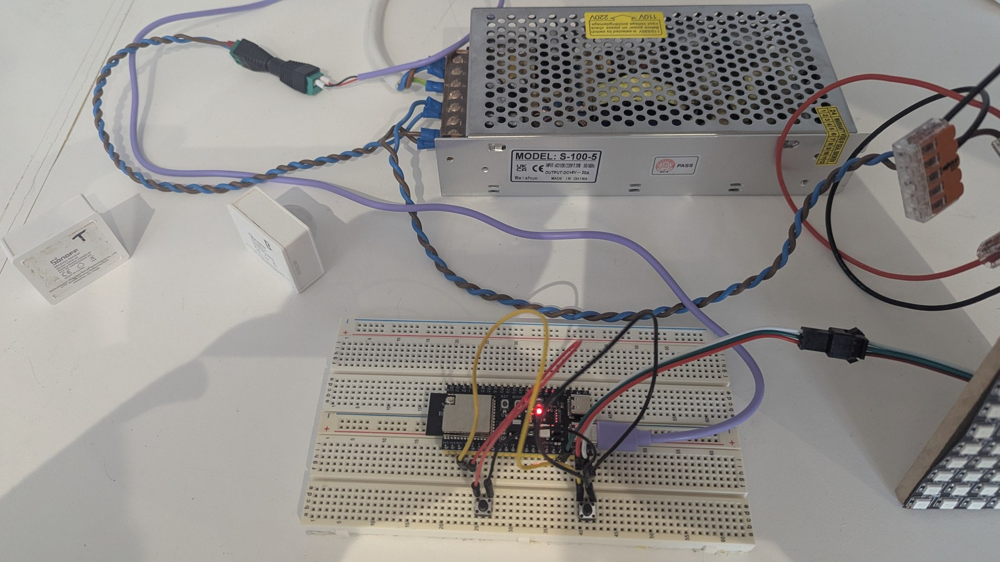

[All parts](../../README.md#the-parts) · [Part 2 · Wiring and power →](../02-wiring/README.md)

# Part 1 · Hardware

*Click the diagram to open it full screen.*

What the controller is made of, and why each piece was chosen over the obvious
cheaper option.

> **This is a prototype rig, not a fitted staircase.** The two panels stand in
> for the steps — one row of 8 LEDs per step — so the whole 64-step effect can be
> seen at once on a bench. On real stairs the panels become one short strip per
> step, wired as a single chain; nothing else changes.

*The rig from above: the ESP32-S3 on a breadboard with the two diagnostic
buttons, the 5 V supply behind it, the two Zigbee PIRs (Sonoff SNZB-03, marked
**T** and **B**) on the left, and the foot of the matrix on the right.*

## At a glance

| | |
|---|---|
| **Built from** | diymore ESP32-S3 DevKitC-1 N16R8, two 32 × 8 WS2812B panels, a 5 V 20 A supply |
| **Files in this folder** | this page only |
| **Also needs** | [Part 2 · Wiring and power](../02-wiring/README.md) for how it all joins up |
| **Drives** | 512 LEDs as one 8 × 64 matrix: 64 rows of 8, one row per step |
| **Costs** | about £55 for the board, panels and supply, at 2026 UK prices |

## The parts

| Part | What I used | Why this one |
|---|---|---|
| Controller | **diymore ESP32-S3 DevKitC-1 N16R8** — 16 MB flash, 8 MB octal PSRAM, USB-C | WLED only allows more than 32 segments on a board with PSRAM, and 64 steps needs 64 segments. The S3 also has the headroom for 2D effects and, later, a microphone |
| LEDs | **Two 32 × 8 WS2812B panels**, chained into one 8 × 64 matrix: 512 LEDs | A panel row is a tidy stand-in for a step: 8 LEDs wide, addressable as a block. On real stairs this is one short strip per step, wired as one long chain |
| Power | **5 V 20 A** supply (Weishuo S-100-5, 100 W), feeding the panels at both ends | 512 LEDs at full white would want about 28 A, more than this supply gives, so WLED's limiter caps them at 17 A. With every step lit, the sweep's warm white comes to about 17.5 A, so it gets trimmed by a few percent, which you can't see. Full white would be cut by about 40 %. See [Power: one source at a time](../../shared/README.md#power-one-source-at-a-time) |
| Diagnostics | **2 × momentary push buttons** (bottom and top), to GND, no resistors | **Not how the stairs are used.** They override every condition and exist to prove the controller and the LEDs work — see [Part 2](../02-wiring/README.md#the-two-buttons-are-a-diagnostic). The firmware uses the ESP32's internal pull-ups, so a press pulls the pin low. Patch P4 in [Part 4](../04-behaviour-patches/README.md) |
| **Triggers** | **2 × Zigbee PIRs already in Home Assistant**, one at each end | **This is how the stairs are actually used.** They never touch the ESP32: Home Assistant turns a PIR into a preset selection, so the sensors can be any kind Home Assistant can see |
| Microphone | **INMP441 I2S** — specified, **not fitted yet** | Only the Disco preset wants it. The firmware is already built with `audioreactive` and the pins are set, so fitting it later needs no rebuild |

A classic ESP32 will not do this build: without PSRAM, WLED caps segments at 32,
and it has neither the RAM nor the speed for a 512-LED 2D matrix with sound
input.

## Settings I chose

- **8 LEDs per step.** Wide enough to look like a lit step rather than a dot,
  narrow enough that 64 steps stay inside one data line.
- **One data pin for all 512 LEDs.** 512 pixels on one WS2812B line refreshes at
  about 42 fps, which is plenty for a sweep. Splitting across two pins would buy
  frame rate the project doesn't need.
- **17 A power limit** in WLED, about 85 % of the supply's 20 A rating. WLED dims
  globally rather than letting the rail sag.
- **Power injection at the far end** of the chain, so the top steps aren't dim
  and yellow.

## Choices worth explaining

1. **ESP32-S3 with PSRAM, not a classic ESP32.** One segment per step means the
   segment count is the step count, and WLED only allows more than 32 segments
   on a board with PSRAM. The S3 also has the headroom for the 2D effects the
   Matrix and Disco presets use, and for the microphone later.
2. **One chained matrix, not a strip per step.** WLED can then address the whole
   staircase as a 2D area when an effect wants to, and as 64 one-row segments
   when the sweep wants to. Both layouts live in presets, not in the firmware.
3. **Internal pull-ups, not pull-down resistors.** The usual WLED wiring puts a
   button between the pin and 3.3 V with a 10 kΩ pull-down to ground, and a
   missing resistor leaves the pin reading "pressed" forever. Here the buttons
   go straight to ground and the firmware enables the ESP32's own pull-ups, so
   there is no resistor to forget (patch P4 in
   [Part 4](../04-behaviour-patches/README.md)).

## Add just this part

1. Buy the board, the panels and a supply. LEDs × 60 mA is the worst case at
   full white. Either size the supply for that with about 20 % headroom, or do
   what this build does: use a smaller supply and set the power limiter to about
   85 % of its rating, so WLED dims rather than overloads it.
2. Count your steps. That number is `--rows` everywhere in this repo, and it must
   be 64 or fewer (the firmware's compiled-in segment limit).
3. Decide the LEDs per step. That is `--width`.
4. Carry on to [Part 2 · Wiring and power](../02-wiring/README.md).

---

[All parts](../../README.md#the-parts) · [Part 2 · Wiring and power →](../02-wiring/README.md)
