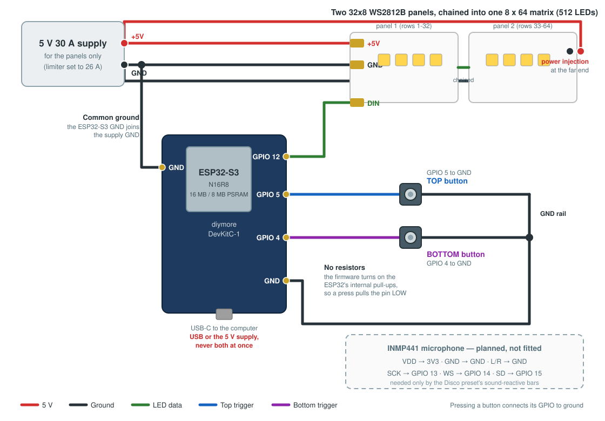
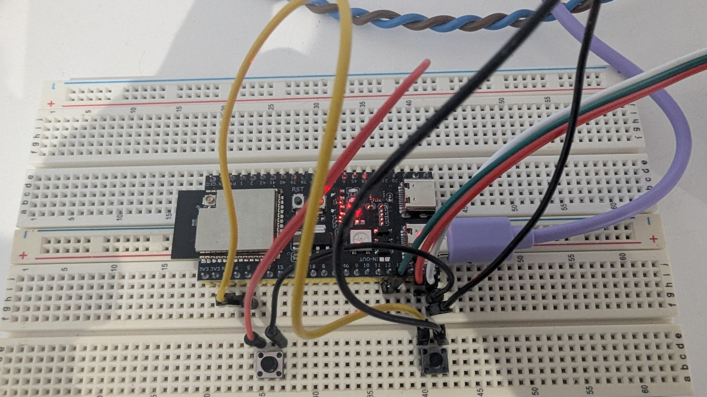

[← Part 1 · Hardware](../01-hardware/README.md) · [All parts](../../README.md#the-parts) · [Part 3 · Firmware →](../03-firmware/README.md)

# Part 2 · Wiring and power

*Click the diagram to open it full screen.*

Five wires and two buttons. The only things that bite are the common ground, the
two 5 V sources, and which end of the chain the data goes in.

**Nothing here is how the stairs are normally triggered.** That is the two Zigbee
PIRs, which never touch this board — they reach the controller through Home
Assistant ([Part 7](../07-home-assistant/README.md)). The two buttons are a
diagnostic, described below.

*The controller as built: the ESP32-S3 on a breadboard, the three-wire LED cable
coming in on the right, and the two diagnostic buttons below it, each wired
between its GPIO and ground with no resistor.*

## At a glance

| | |
|---|---|
| **Built from** | the parts in [Part 1](../01-hardware/README.md) |
| **Files in this folder** | `wiring.svg` (the diagram above) |
| **Also needs** | nothing |
| **Uses** | GPIO 12 (LED data), GPIO 4 (bottom diagnostic button), GPIO 5 (top diagnostic button), GND, and GPIO 13/14/15 reserved for the microphone |
| **Explains** | why there are no resistors, and why USB and the 5 V supply must never be connected together |

## The connections

| From | To | Notes |
|---|---|---|
| Supply **+5V** | Panel 1 **+5V**, and panel 2 **+5V** | Both ends: the far-end feed is the power injection |
| Supply **GND** | Panel 1 **GND**, panel 2 **GND**, **and the ESP32-S3 GND** | The common ground is not optional. Without it the LEDs ignore the data |
| ESP32-S3 **GPIO 12** | Panel 1 **DIN** | Data goes in at the **bottom** step and flows the way the panel's arrows point |
| ESP32-S3 **GPIO 4** | One leg of the **bottom** button; other leg to **GND** | No resistor |
| ESP32-S3 **GPIO 5** | One leg of the **top** button; other leg to **GND** | No resistor |
| Panel 1 **DOUT** | Panel 2 **DIN** | Already chained on these panels |

A 330 Ω resistor in the data line, close to the first LED, is good practice on a
long run. This build works without it; add it if you see random flicker.

## Settings I chose

- **GPIO 12 for data.** Free on the S3, not a strapping pin, and away from the
  pins the USB-serial and PSRAM use.
- **GPIO 4 and 5 for the buttons.** Adjacent, free, and both safe to pull low at
  boot. The usermod has exactly these two inputs, so **any further buttons need
  their own GPIOs** and their own handling — see below.
- **GPIO 13 / 14 / 15 reserved** for the microphone's SCK / WS / SD, so fitting
  it later doesn't move anything.

## The two buttons are a diagnostic

On this prototype the buttons are **not a control**. They are two momentary
switches on the controller itself, locked away, used perhaps twice a year.

**They override everything.** Daylight, the house motion toggle, the alarm, and
Home Assistant being down or Zigbee having dropped — none of it reaches them,
because the wire goes straight to the GPIO. Their one job is to answer a single
question with no dependencies: *are the controller and the LEDs still working?*
That is why they are deliberately ungated, and why the firmware never
second-guesses a physical press.

**The PIRs are the real interface.** Walking up or down is what lights the
stairs. Everything else in this project — the sensors, the card buttons, the
modes, Danger — is described in [Part 7](../07-home-assistant/README.md); the
four ways in and how each one is gated are in
[that part's table](../07-home-assistant/README.md#the-four-ways-in-gated-differently).

**If you want real wall switches**, treat these two as taken and wire yours to
**additional GPIOs**. The usermod reads one bottom pin and one top pin and
nothing else, so extra switches need either their own handling in the firmware or
— far easier — a Zigbee or Wi-Fi button that Home Assistant can turn into a
preset selection, exactly as it already does for the PIRs.

## Why there are no resistors

A button here shorts its GPIO to ground. The firmware sets both trigger pins to
`INPUT_PULLUP` and treats **LOW as triggered** (patch P4, [Part 4](../04-behaviour-patches/README.md)),
so the pin idles high on the ESP32's own internal resistor and no external part
is needed.

Stock WLED does the opposite — it expects a PIR to pull the pin **high** — which
is why the usual wiring needs a 10 kΩ pull-down on each button, and why a missing
one leaves the staircase thinking a button is held down forever.

The trigger presets Home Assistant uses (`zz Trigger Bottom` / `zz Trigger Top`)
still work either way, because they set the sensor flag in software rather than
through the pin.

## ⚠️ USB or the 5 V supply, never both

The board can take 5 V from the supply or from USB. Both at once back-feeds one
into the other.

- **On the stairs:** supply connected, USB unplugged.
- **At the desk, flashing or testing:** USB connected, the supply's 5 V wire off
  the board. The panels stay dark, which is fine — everything except the LEDs
  can be tested that way.

## Add just this part

1. Wire power and ground as in the table, including the ESP32-S3's ground.
2. Wire GPIO 12 to the first panel's DIN.
3. Wire both buttons to ground.
4. Feed the far end of the chain from the same supply.
5. With the firmware on ([Part 3](../03-firmware/README.md)), check both buttons
   with `python3 parts/08-testing/check_device.py --host <ip>`: *Trigger inputs
   idle* must pass while nothing is pressed.
6. Press the bottom button. If the **top** of the stairs lights first, swap the
   GPIO 4 and GPIO 5 wires, or swap the two pins in the usermod settings.

---

[← Part 1 · Hardware](../01-hardware/README.md) · [All parts](../../README.md#the-parts) · [Part 3 · Firmware →](../03-firmware/README.md)
